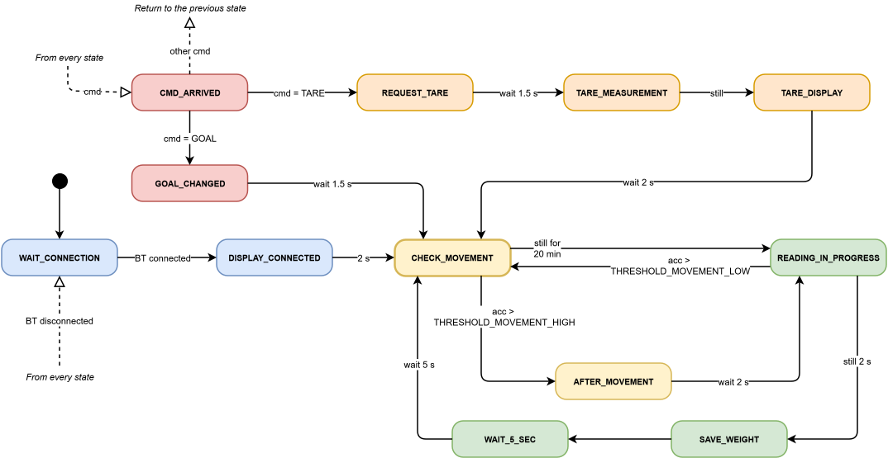

# Borraccia Smart – ESP32

Progetto IoT per il monitoraggio dell'idratazione personale.

La borraccia rileva autonomamente quanto si beve durante la giornata tramite una bilancia interna (HX711), notifica l'utente via Bluetooth Classic e mostra le informazioni su un display OLED da 0.91".

---

## Hardware collegato

| Componente | Interfaccia | Funzione |
|---|---|---|
| **ESP32** | – | Microcontrollore principale |
| **MPU9250** | I2C | Accelerometro/giroscopio: rileva movimento |
| **AHT20** | I2C | Sensore di temperatura e umidità |
| **HX711** | – | ADC per cella di carico (bilancia) |
| **OLED 128x32** | I2C (SSD1306) | Display informazioni |

---

## Comunicazione

Bluetooth Classic (SPP) tramite libreria `BluetoothSerial`.
Il dispositivo si chiama **"SipWise"** ed è visibile dall'app mobile non appena avviato.

---

## Calibrazione HX711

Fattore di calibrazione = **211**.

Calcolato dividendo il valore raw letto con un peso campione noto per il suo valore in grammi.

---

## Macchina a stati (FSM – Finite State Machine)



<!--
```text
ATTESA_CONNESSIONE
    │  (BT connesso)
    ▼
CONNESSO_DISPLAY  ──(2 s)──▶  CONTROLLO_MOVIMENTO
                                    │
                      ┌─────────────┴─────────────┐
                      │ (acc > SOGLIA_GRANDE_MOV)  │ (fermo da 20 min)
                      ▼                            ▼
              DOPO_GRANDE_MOVIMENTO          LETTURA_IN_CORSO
                      │ (fermo da 2 s)            │
                      └──────────────┬────────────┘
                                     │ (stabile 500ms)
                                     ▼
                                 SALVA_PESO
                                     │
                                     ▼
                                ATTESA_5_SEC  ──(5 s)──▶  IDLE_COMANDI
                                                                │
                                     ┌──────────────────────────┤
                                     │ (TARA via BT)            │ (timeout 15 s)
                                     ▼                          ▼
                              RICHIESTA_TARA         CONTROLLO_MOVIMENTO
                                     │ (1,5 s)
                                     ▼
                                MISURA_TARA
                                     │ (fermo)
                                     ▼
                               TARA_DISPLAY  ──(2 s)──▶  CONTROLLO_MOVIMENTO
```
-->

---

## Orologio interno (RTC hardware ESP32)

L'ESP32 dispone di un RTC (Real Time Clock) integrato nel chip, gestito automaticamente dal framework tramite le API POSIX standard `<sys/time.h>`.

L'app invia il timestamp UNIX corrente con `TIME:<epoch>`: il firmware imposta il RTC con `settimeofday()` e da quel momento `time(nullptr)` restituisce sempre l'ora corretta.

Il RTC mantiene l'ora durante il deep/light sleep ma si azzera al riavvio completo, quindi serve una risincronizzazione ad ogni accensione tramite l'app.

### Cambio di giorno (mezzanotte)

A mezzanotte il dispositivo:

1. Invia all'app il totale di acqua bevuta nella giornata appena conclusa (messaggio `GIORNATA,<ml>`)
2. Azzera il contatore `waterDrinked_ml` per il nuovo giorno

---

## Protocollo Bluetooth

Protocollo testuale, ogni messaggio è terminato da `\n`.

### Comandi ricevuti (app → ESP32)

| Comando | Descrizione |
|---|---|
| `WEIGHT:<kg>` | Imposta il peso corporeo dell'utente |
| `AGE:<age>` | Imposta l'età dell'utente |
| `GOAL:<auto>,<ml>` | Cambia il target idrico giornaliero |
| `TIME:<epoch>` | Sincronizza l'orologio interno (Unix timestamp) |
| `TARE` | Avvia la procedura di tara della bilancia |
| `SEND` | Richiede l'invio immediato dei dati attuali |
| `SEND_DAY` | Richiede l'invio del totale acqua giornaliero |

### Risposte inviate (ESP32 → app)

| Messaggio | Descrizione |
|---|---|
| `DATA,<waterDrunk>,<waterGoal>,<weight>,<temp>,<humidity>` | Dati attuali della borraccia |
| `DAY,<ml>` | Totale giornaliero (automatico a mezzanotte o su `SEND_DAY`) |
| `OK:TARE` | Conferma tara eseguita |
| `OK:RESET` | Conferma reset contatore |
| `OK:GOAL` | Conferma nuovo obiettivo impostato |
| `OK:TIME` | Conferma sincronizzazione orologio |
| `ERR:TIME` | Timestamp ricevuto non valido (< anno 2001) |
